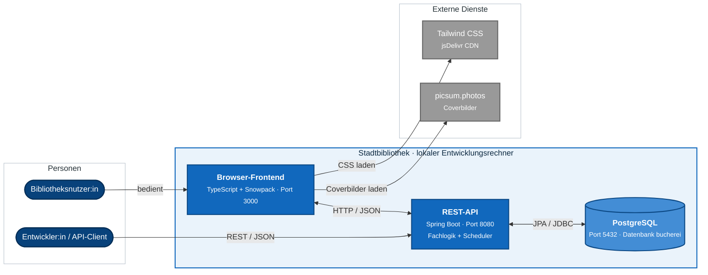

# Stadtbibliothek

Die Stadtbibliothek ist eine lokale Full-Stack-Webanwendung zur Verwaltung
eines Bibliotheksbestands. Bücher können nach Titel oder Autor gesucht, mit
Standort und Verfügbarkeit angezeigt und für einen Demonstrationsnutzer
reserviert werden.

Das Projekt besteht aus einem TypeScript-Frontend, einer REST-API mit Spring
Boot und einer PostgreSQL-Datenbank. Beim Start erzeugt das Backend automatisch
Demodaten, sodass die Anwendung direkt ausprobiert werden kann.

## Systemarchitektur



## Funktionsumfang

### Browseroberfläche

- Suche nach Buchtitel oder Autor
- Anzeige von Cover, Standort und Verfügbarkeitsstatus
- Reservierung verfügbarer Bücher
- Anzeige der Reservierungen des Demonstrationsnutzers mit ID `1`
- Benutzerkonto mit beispielhafter Darstellung von Ausleihen und Fristen

### Backend

- Verwaltung und Suche von Medien
- Registrierung und Abruf von Nutzern
- Anlegen, Abrufen und Stornieren von Reservierungen
- Erfassen und Verlängern von Ausleihen
- automatische Freigabe abgelaufener Reservierungen
- Erzeugung von zehn Büchern, Standorten und einem Testnutzer beim Start

Ein Teil der Backend-Funktionen ist noch nicht mit einer aktiven
Frontend-Interaktion verbunden. Dazu gehören insbesondere das Stornieren von
Reservierungen sowie das Erfassen und Verlängern von Ausleihen.

## Anwendung

| Startseite | Benutzerkonto | Suchergebnisse |
| --- | --- | --- |
|  |  |  |

## Technischer Aufbau

| Bereich | Technologie | Aufgabe |
| --- | --- | --- |
| Frontend | TypeScript 4.2.4 und Snowpack 3.3.7 | Browserlogik und lokaler Entwicklungsserver |
| Styling | Tailwind CSS 2.2.19 über CDN | Gestaltung der HTML-Seiten |
| Backend | Java 21 und Spring Boot 3.4.4 | REST-API, Fachlogik und Scheduler |
| Persistenz | Spring Data JPA / Hibernate und PostgreSQL | Relationale Datenhaltung |

Frontend und Backend laufen als getrennte Prozesse. Der Browser lädt die
Oberfläche von Port `3000` und ruft die API auf Port `8080` per HTTP/JSON auf.

## Voraussetzungen

- Java 21
- Node.js mit npm
- PostgreSQL auf `localhost:5432`
- Datenbank `bucherei`

Benutzername und Passwörter werden nicht im Repository gespeichert. Vor dem
Backend-Start müssen `DB_USERNAME`, `DB_PASSWORD` und `DEMO_USER_PASSWORD`
gesetzt werden. Optional überschreibt `DB_URL` die lokale Standardverbindung
`jdbc:postgresql://localhost:5432/bucherei`. Das Schema wird bei jedem
Backend-Start neu erstellt und beim Herunterfahren wieder gelöscht.

## Schnellstart

### 1. Backend starten

Ausgehend vom Projektverzeichnis:

```powershell
cd backend/Bücherei
$env:DB_USERNAME = "<eigener-datenbankbenutzer>"
$env:DB_PASSWORD = "<eigenes-datenbankpasswort>"
$env:DEMO_USER_PASSWORD = "<eigenes-demo-passwort>"
.\mvnw.cmd spring-boot:run
```

### 2. Frontend starten

In einem zweiten Terminal:

```powershell
cd frontend
npm install
npm start
```

Danach stehen folgende Adressen zur Verfügung:

| Ziel | Adresse |
| --- | --- |
| Anwendung | `http://localhost:3000` |
| REST-API | `http://localhost:8080/api` |
| Swagger UI | `http://localhost:8080/swagger-ui/index.html` |
| OpenAPI-Dokument | `http://localhost:8080/v3/api-docs` |

## Tests und Prüfungen

Frontend:

```powershell
cd frontend
npm test
npm run lint
npm run build
```

Backend:

```powershell
cd backend/Bücherei
.\mvnw.cmd test
```

## Projektstruktur

```text
.
├── frontend/
│   ├── public/                # HTML-Seiten
│   └── src/                   # Views, API-Clients und Modelle
├── backend/Bücherei/
│   └── src/
│       ├── main/              # Spring-Boot-Anwendung
│       └── test/              # Backend-Tests
└── docs/                      # Architektur-, API- und Entwicklungsdokumentation
```

## Dokumentation

- [Architektur und Datenmodell](docs/ARCHITEKTUR.md)
- [REST-API-Referenz](docs/API.md)
- [Lokale Entwicklung](docs/ENTWICKLUNG.md)

## Lizenz

Für das Projekt ist derzeit keine Lizenz hinterlegt.
