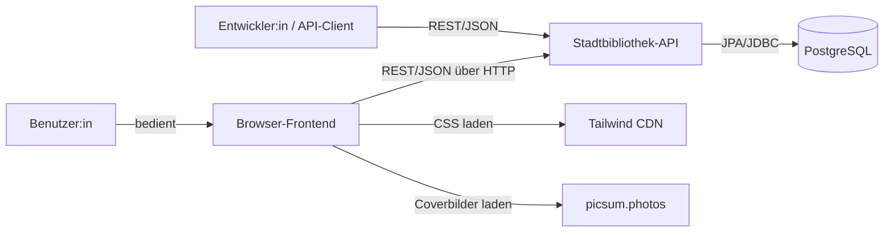
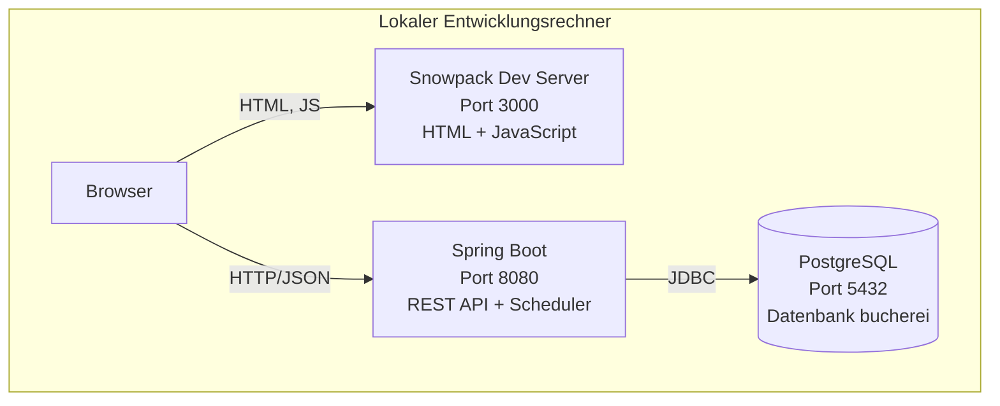
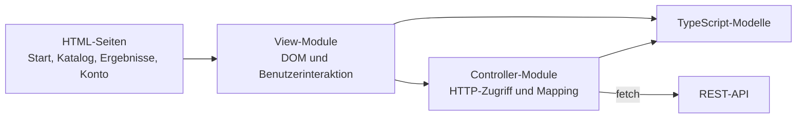
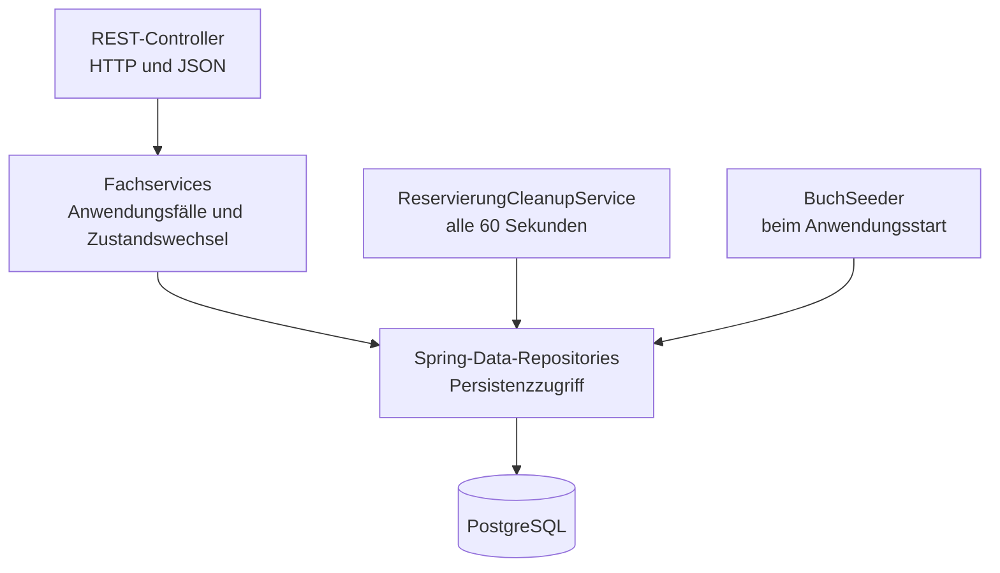
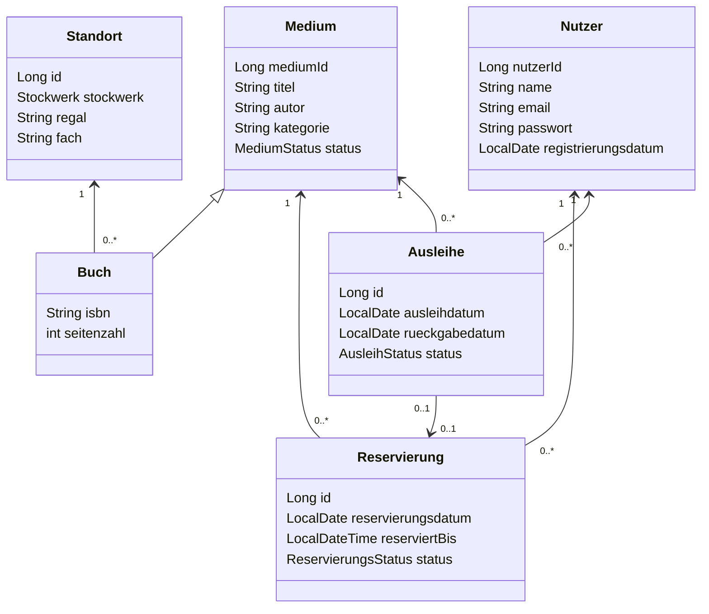
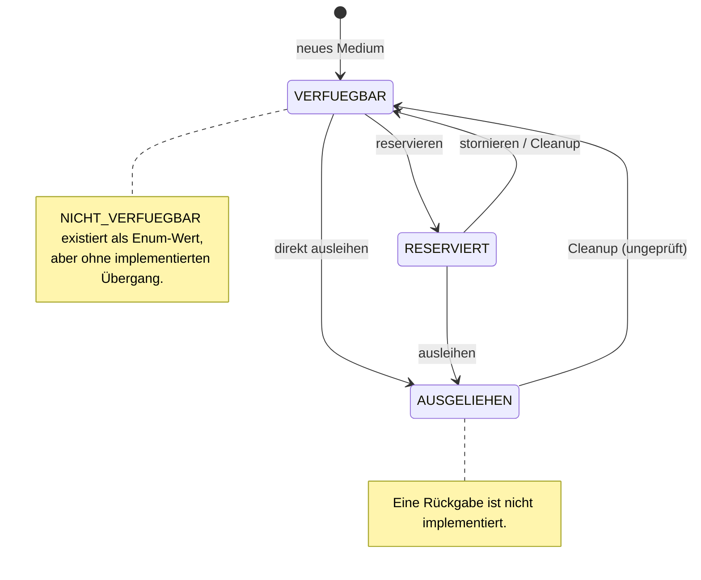
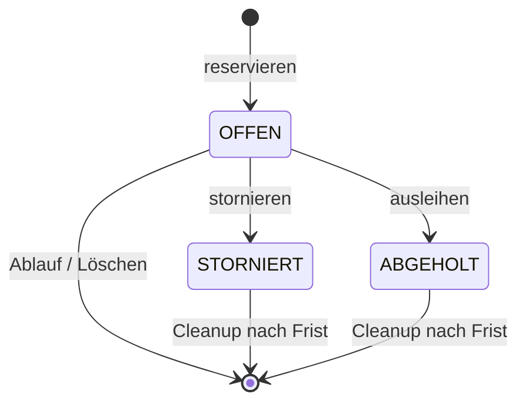
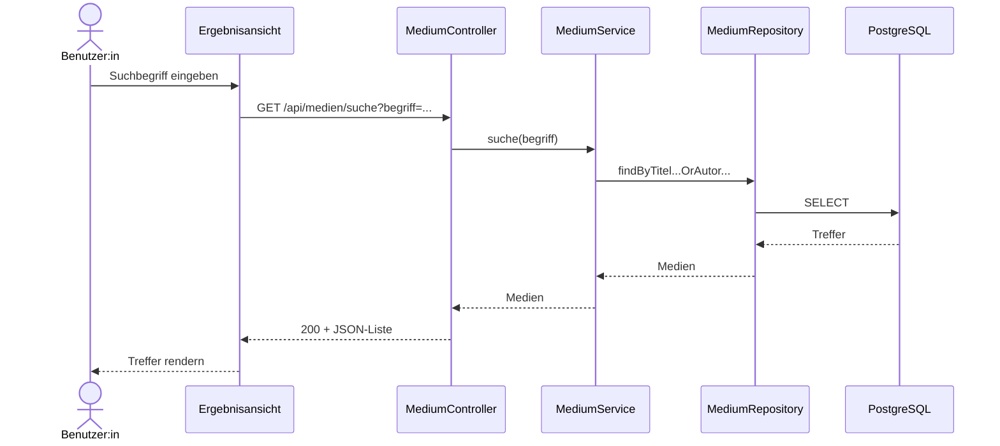
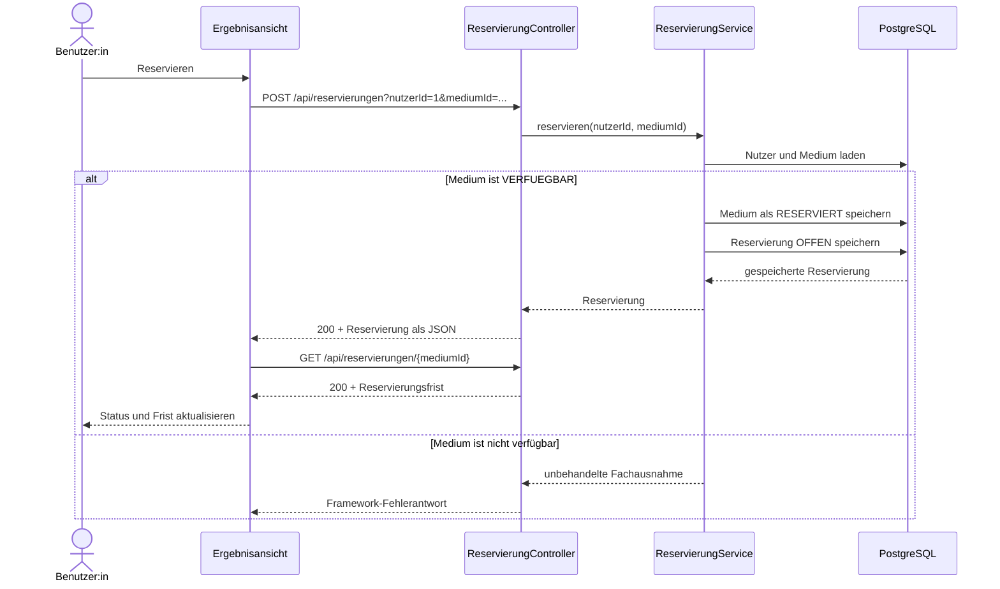
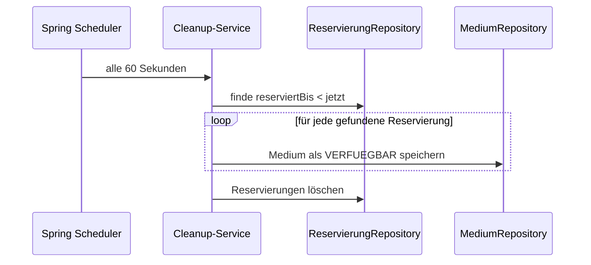

# Architektur der Stadtbibliothek

## 1. Ziel und Systemgrenze

Die Stadtbibliothek ist eine lokale Webanwendung zur Verwaltung eines
Medienbestands. Benutzer:innen können Bücher nach Titel oder Autor suchen,
Standort und Verfügbarkeit einsehen und verfügbare Bücher reservieren. Das
Backend verwaltet außerdem Nutzer, Reservierungen und Ausleihen.

Zum betrachteten System gehören:

- die statischen Browserseiten und ihre TypeScript-Logik,
- die REST-Schnittstelle des Spring-Boot-Backends,
- die fachliche Anwendungslogik,
- die relationale Datenhaltung in PostgreSQL und
- die zeitgesteuerte Bereinigung abgelaufener Reservierungen.

Nicht implementiert sind insbesondere Anmeldung und Rollen, Rückgabe von
Ausleihen, Benachrichtigungen, Zahlungen, ein Bibliotheksverbund sowie ein
Produktions- oder Cloudbetrieb.

## 2. Architekturtreiber und Randbedingungen

| Treiber / Randbedingung | Auswirkung auf die Architektur |
| --- | --- |
| Einfach lokal ausführbarer Demonstrator | Ein Frontend-Dev-Server, ein Backend-Prozess und eine lokale PostgreSQL-Instanz genügen. |
| Nachvollziehbarer fachlicher Ablauf | Controller, Services und Repositories sind getrennt; Zustände werden als Enums modelliert. |
| Browserbasierte Bedienung | Frontend und Backend kommunizieren synchron über HTTP/JSON. |
| Relationale Fachdaten | JPA-Entities bilden Medien, Nutzer, Reservierungen, Ausleihen und Standorte ab. |
| Kurze Lebensdauer der Testdaten | Hibernate erzeugt und löscht das Schema bei jedem Backend-Lauf; ein Seeder legt Demodaten an. |
| Kein Produktionsanspruch | Sicherheit, Fehlertoleranz, Migrationen und Observability sind nur rudimentär oder nicht vorhanden. |

## 3. Systemkontext

Das Backend speichert für Demomedien lediglich von `picsum.photos` abgeleitete
Bild-URLs. Die Bilder selbst werden erst durch den Browser geladen. Für CSS
greifen die HTML-Seiten zur Laufzeit auf das jsDelivr-CDN zu. Fällt einer dieser
externen Dienste aus, bleiben die Fachdaten erreichbar, Darstellung oder
Coverbilder können jedoch fehlen.

## 4. Container- und Deployment-Sicht

Die Topologie ist fest auf die lokale Entwicklung zugeschnitten:

- Das Frontend verwendet die fest eingetragene API-Basis-URL
  `http://localhost:8080`.
- CORS erlaubt den Ursprung `http://localhost:3000` und alle HTTP-Methoden.
- Die Datenbankverbindung verweist auf
  `jdbc:postgresql://localhost:5432/bucherei`; Benutzername und Passwörter
  werden über die Umgebungsvariablen `DB_USERNAME`, `DB_PASSWORD` und
  `DEMO_USER_PASSWORD` bereitgestellt.
- `spring.jpa.hibernate.ddl-auto=create-drop` verwirft alle Daten nach dem
  Herunterfahren. `BuchSeeder` legt beim Start zehn Bücher und einen
  Demonstrationsnutzer an.
- Container, Reverse Proxy, TLS, CI/CD, Monitoring, Backups und
  Hochverfügbarkeit sind nicht konfiguriert.

## 5. Bausteinsicht

### 5.1 Frontend

| Baustein | Verantwortung |
| --- | --- |
| `frontend/public` | Statische Seiten und Einstiegspunkte. |
| `frontend/src/views` | DOM-Rendering, Suche und Reservierungsinteraktion. |
| `frontend/src/controller` | `fetch`-Aufrufe und Mapping der JSON-Antworten. |
| `frontend/src/models` | Clientseitige Repräsentationen der Fachdaten. |

Die Oberfläche hat keine Sitzung oder Anmeldung und arbeitet an den
entscheidenden Stellen mit der fest codierten Nutzer-ID `1`. Die Bezeichnung
„Controller“ im Frontend meint API-Clients und ist nicht mit den
Spring-MVC-Controllern zu verwechseln.

### 5.2 Backend

| Baustein | Verantwortung |
| --- | --- |
| `MediumController` / `MediumService` | Medien anlegen, lesen und nach Titel oder Autor suchen. |
| `NutzerController` / `NutzerService` | Nutzer registrieren und lesen; E-Mail-Eindeutigkeit prüfen. |
| `ReservierungController` / `ReservierungService` | Reservieren, stornieren und Reservierungen abfragen. |
| `AusleiheController` / `AusleiheService` | Ausleihen erfassen und Rückgabedaten verlängern. |
| `ReservierungCleanupService` | Zeitlich abgelaufene Reservierungen löschen und Medien freigeben. |
| Repositories | Entities laden und speichern; abgeleitete Suchabfragen ausführen. |

Die Anwendung ist ein **geschichteter Monolith**. Der Scheduler läuft im selben
Prozess wie die API; es gibt weder einen separaten Worker noch einen Message
Broker. Die PostgreSQL-Datenbank ist die einzige persistente Source of Truth.

## 6. Domänen- und Datenmodell

`Medium` ist eine abstrakte JPA-Entity. `Buch` wird über die
Vererbungsstrategie `JOINED` in einer eigenen Tabelle ergänzt. Die Beziehungen
zu Nutzer und Medium sind aus Sicht von Reservierung und Ausleihe `ManyToOne`;
eine Ausleihe kann zusätzlich genau eine Reservierung referenzieren.

Die API verwendet die JPA-Entities direkt als Request- und Response-Modelle.
Damit bilden Datenbankmodell und externer JSON-Vertrag derzeit eine gemeinsame
Änderungsgrenze.

### 6.1 Zustandsübergänge

Die folgenden Diagramme zeigen ausschließlich die im Code vorhandenen
Übergänge.

Der Cleanup selektiert technisch nach `reserviertBis`, nicht nach dem Status.
Dadurch können auch bereits stornierte oder abgeholte Reservierungen in die
Bereinigung gelangen. `AusleihStatus.ZURUECKGEGEBEN` existiert, wird aber durch
keinen Anwendungsfall gesetzt.

## 7. Laufzeitsicht

### 7.1 Katalogsuche

Der Client URL-codiert den Suchbegriff. Die Datenbankabfrage sucht ohne
Beachtung der Groß-/Kleinschreibung in Titel und Autor. Paginierung sowie eine
inhaltliche Begrenzung des Suchbegriffs fehlen.

### 7.2 Reservierung

Eine neue Reservierung läuft nach `3880` Minuten ab. Das Speichern von Medium
und Reservierung ist nicht durch eine explizite Service-Transaktion geschützt.
Auch eine Sperr- oder Versionsstrategie für gleichzeitige Anfragen fehlt.

### 7.3 Automatische Bereinigung

Der Ablauf ist nicht transaktional. Bei mehreren Backend-Instanzen würde jeder
Prozess denselben Scheduler ausführen; eine verteilte Sperre ist nicht
vorhanden.

## 8. Wesentliche Architekturentscheidungen

| Entscheidung | Begründung | Konsequenz |
| --- | --- | --- |
| Getrenntes statisches Frontend und REST-Backend | Klare Trennung von Darstellung und Fachlogik. | Zwei lokale Prozesse, CORS und eine konfigurierte API-Basis-URL sind erforderlich. |
| Geschichteter Backend-Monolith | Für Umfang und Lernziel leicht verständlich. | Deployment ist einfach; Skalierung und Fehlerisolation erfolgen nur für das gesamte Backend. |
| PostgreSQL mit JPA | Relationen und Statusdaten lassen sich direkt persistieren. | Entity-Modell und Schema sind eng gekoppelt; Migrationen fehlen. |
| In-Process-Scheduler | Ablaufende Reservierungen ohne zusätzliche Infrastruktur bearbeiten. | Bei Ausfall verzögert sich die Bereinigung; mehrere Instanzen würden Koordination benötigen. |
| Entities als API-Modelle | Wenig Mapping-Code im Demonstrator. | Interne Felder und Beziehungen gelangen in den Vertrag; Sicherheit und Weiterentwicklung werden erschwert. |
| `create-drop` und Start-Seeder | Jeder lokale Lauf beginnt mit verwendbaren Demodaten. | Daten sind nicht dauerhaft und der Modus ist für Produktion ungeeignet. |

## 9. Technologieübersicht

| Bereich | Technologie | Einsatz |
| --- | --- | --- |
| Frontend | TypeScript 4.2.4 und Snowpack 3.3.7 | Browserlogik, Typisierung und lokaler Entwicklungsserver |
| Styling | Tailwind CSS 2.2.19 über CDN | Gestaltung der statischen HTML-Seiten |
| Backend | Java 21 mit Spring Boot 3.4.4 | REST-API, Dependency Injection, Konfiguration und Scheduler |
| Persistenz | Spring Data JPA / Hibernate mit PostgreSQL | Relationale Speicherung und Repository-Abstraktion |
| API-Dokumentation | springdoc OpenAPI 2.8.5 | Generierung der OpenAPI- und Swagger-Darstellung |
| Tests | Jest 29.7.0, ts-jest 29.3.2 und Spring Boot Test | Frontend- und Backend-Tests |

Die detaillierten HTTP-Endpunkte und Repräsentationen stehen in der
[API-Referenz](API.md). Hinweise zum lokalen Start und zu den Prüfkommandos
enthält die [Entwicklungsdokumentation](ENTWICKLUNG.md).
